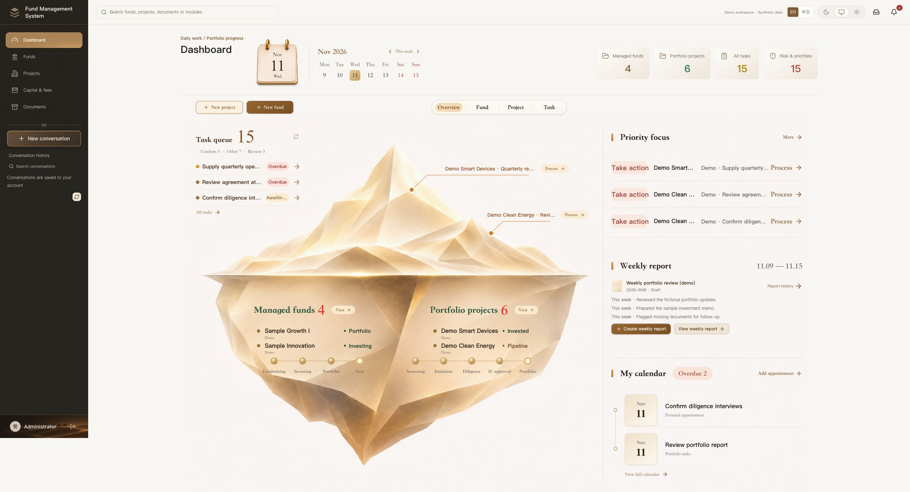
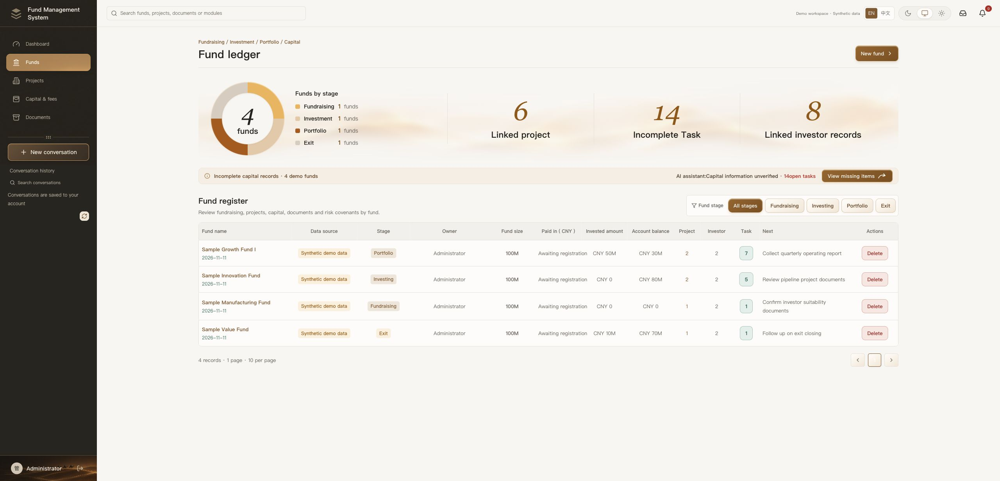
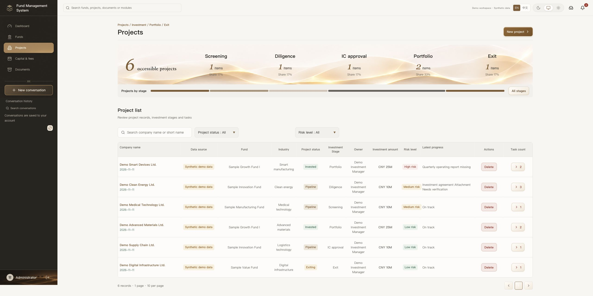
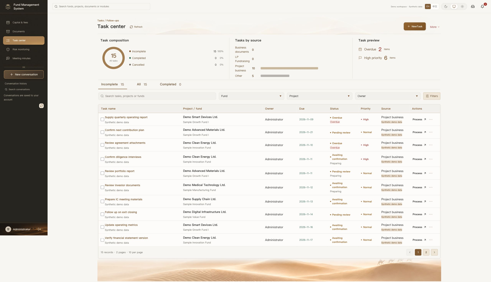
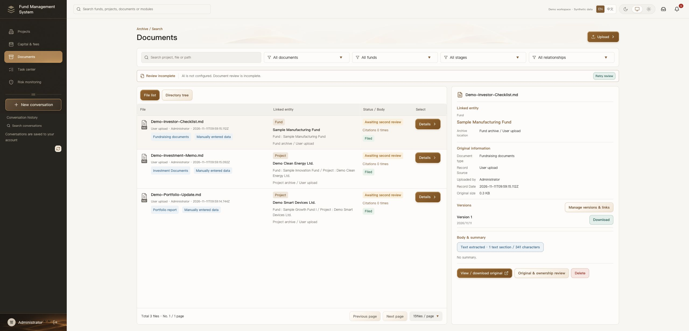

# Fund Management System

[English](README.md) · [中文](README.zh-CN.md)

An open-source workspace for fund operations: fund lifecycle, deal and project tracking, tasks, approvals, documents, risk, capital and fees.

**In development.** The included organizations, people, documents, amounts and activity are fictional demo data. This repository does not include a customer database, customer files, credentials or private deployment configuration. Example requirements and financial rules must be reviewed for the intended organization and jurisdiction before real use.



## Try the local demo

Requirements: Node.js **22.18+**, npm, Git. No database or AI key is needed for the local demo.

```sh
git clone https://github.com/i540337191-create/fund-management-system.git
cd fund-management-system
npm ci
npm --prefix server ci
npm run demo
```

Open **http://127.0.0.1:15248/dashboard**. English is the default; use **中文** in the header to switch languages. The toggle preserves form values. Funds and projects use the same underlying business values in both languages.

The demo binds to localhost, uses an isolated in-memory store and stores uploaded demo files in the ignored `.demo-files/` directory. It does not connect to a database, even if `DATABASE_URL` is set in your shell. Data resets when the API restarts. This mode is for local evaluation, not a publicly exposed multi-user deployment.

Optional ports:

```sh
DEMO_WEB_PORT=15348 DEMO_API_PORT=18928 npm run demo
```

## What is included

- A gold iceberg dashboard with fund, project and task focus views.
- Fund lifecycle and investor records; deal/project stages and linked follow-ups.
- Tasks, approval queues, notifications and weekly reports.
- Document upload, version records, previews and evidence links.
- Risk and high-priority work across connected business records.
- Capital and fees, account permissions and configurable business fields/templates.
- Optional AI assistance using your own compatible provider credentials.

The main interface supports English and Chinese. Some less common server-generated messages and exported document templates still use Chinese. Some detailed financial/legal workflows retain organization-specific configuration concepts. This is a development version, not a financial compliance certification or an automated investment-decision product.

## Screenshots

All screenshots below are from the running demo with synthetic data.

| Funds | Projects |
| --- | --- |
|  |  |

| Tasks | Documents |
| --- | --- |
|  |  |

## Development and checks

```sh
npm test
npm run test:api
npm run build
npm run build:api
```

CI validates AI intake persistence with `tests/fixtures/ci-ai-provider.mjs`, a synthetic-only protocol fixture that copies the known test document and labels its output; it does not run a model. The local browser demo does not use this fixture.

Historical tests that depended on private company documents have been replaced by independent synthetic parser/import fixtures. The application ships three new example checklist DOCX files, not the old source documents. No real OCR or AI output is fabricated for the demo.

## Persistent deployment

The API supports PostgreSQL 16 and includes migrations. See `.env.example`, `docker-compose.yml` and `docs/deployment/` for configuration and deployment scripts. Before exposing a deployment, configure password authentication, strong independent secrets, your own database/storage and HTTPS. Never commit `.env` files or uploaded records.

Document generation uses the Python standard library; PDF conversion requires LibreOffice. The API Dockerfile supplies Python, Office/OCR tools and their runtime dependencies. Ubuntu CI installs the same document tools and explicitly sets `DOCUMENT_PYTHON` and `DOCUMENT_SOFFICE`. Local transcription also requires the pinned whisper.cpp runtime and model described below.

### Optional transcription assets

The pinned speech model is stored with **Git LFS**. It is not required for the basic browser demo. For the full Docker/ASR build:

```sh
git lfs install
git lfs pull
```

Sources, hashes and upstream licenses: [`server/vendor/asr/README.md`](server/vendor/asr/README.md). AI provider keys are not bundled. Set the existing `QWEN_*` environment variables or the app's provider settings for optional AI functions; provider usage may incur charges.

## Contributing

Issues and pull requests are welcome. For a bug, include the workflow, expected behavior and a synthetic reproduction. Do not attach customer records, account secrets or personal financial information.

MIT for this project's code. Third-party dependencies and the pinned ASR artifacts retain their respective licenses.
